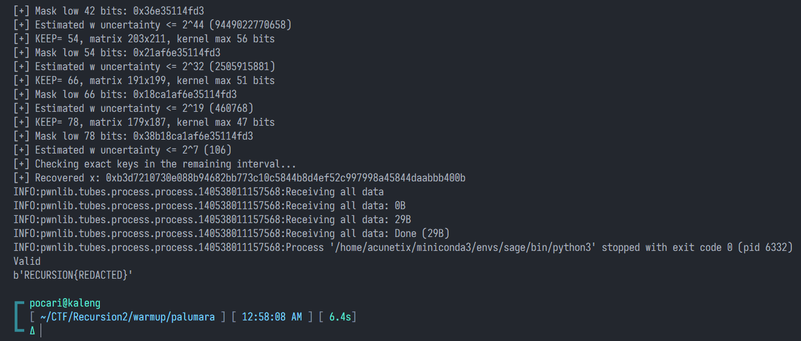

> **Category:** Cryptography  
> **Challenge author:** **azuketto** 🐐

## Introduction

In this challenge, we are given a custom **digital signature scheme** built on **secp256k1**. At first glance, its signing and verification steps look similar to a Schnorr signature: there is a nonce $k$, a point $R=kG$, a hash $e$, and a signature value $s$.

However, two things stand out immediately. First, the nonce is calculated using floating-point arithmetic (`** 0.5`). Second, the private key is multiplied by `e ^ y.y()`. In Python, `^` means **bitwise XOR**, not exponentiation.

This challenge was created by **azuketto**, a crypto GOAT. It reminded me of **Crypto Ponpokurin from NETCOMP 4.0**. To me, Palumara feels like a harder version: even though the nonce is weak, the useful information is hidden behind an unknown XOR mask. This is just my personal comparison, not a claim that the two challenges use exactly the same construction.

The interesting part is that **the server never gives us the public key**. We can only request signatures and receive pairs $(e,s)$ for random messages. Our goal is to create a valid signature for one specific message.

> **TL;DR:** Floating-point arithmetic makes the nonce much more predictable than it should be. We use an *integer kernel* to cancel most of the unknown XOR mask, solve a noisy modular system with a lattice, recover more mask bits step by step, and finally recover the private key and forge a signature.

---

## 1. Understanding the challenge

Here are the important parts of the source code:

```python
E = ecdsa.curves.SECP256k1
g = E.generator * 246
n = E.order
p = E.curve.p()

def keygen():
    x = getRandomRange(1, n - 1)
    y = g * -x
    return x, y

def sign(x, m: bytes):
    k = int(ecdsa.rfc6979.generate_k(
        g.x(), x % g.x(), hashlib.sha512, m
    ) ** 0.5) * p**3 % n
    r = (g * k).x()
    e = int(hashlib.sha256(str(r).encode() + m).hexdigest(), 16)
    s = (k + x * (e ^ (g * -x).y())) % n
    return e, s

def verify(y, m: bytes, e, s):
    r = g * s + y * (e ^ y.y())
    ev = int(hashlib.sha256(str(r.x()).encode() + m).hexdigest(), 16)
    return e == ev
```

The program has three menu options:

1. **Keygen:** Generates a new private/public key pair. We **avoid this option** because we need all signatures to use the same private key.
2. **Sign:** Generates a random 32-byte message, signs it, and returns only $(e,s)$. We do not need to know the message to carry out our attack.
3. **Verify:** Lets us submit our own message and signature $(e,s)$.

We have a limit of **260 menu operations** and a **120-second timeout**. Our plan is to request **259 signatures** and save the final operation for submitting our forged signature.

The target message is:

```python
TARGET = '浮気したらあかんで..., うちがそばにいるのに....!'.encode()
```

### What does the signature equation look like?

Let's define the variables first:

- $G$: the generator point used by the challenge, equal to $246$ times the standard secp256k1 generator.
- $n$: the order of the elliptic-curve group.
- $x$: the secret private key we want to recover.
- $Y=-xG$: the public key, which the server does not reveal.
- $c=y(Y)$: the $y$-coordinate of the public key, treated as a 256-bit integer.
- $e_i,s_i,k_i$: the signature values and nonce for the $i$-th signing request.

The signing equation is:

$$
\boxed{s_i\equiv k_i+x(e_i\oplus c)\pmod n}
$$

Here, $\oplus$ means **bitwise XOR**. This makes the challenge harder than a normal small-nonce attack because the value $c$ is unknown.

---

## 2. Vulnerability #1 — Floating-point destroys the nonce

Take a closer look at this line:

```python
k = int(ecdsa.rfc6979.generate_k(...) ** 0.5) * p**3 % n
```

`generate_k(...)` produces a large integer, up to about 256 bits. But `** 0.5` performs a floating-point calculation. Python floating-point numbers normally have only about **53 bits of significand precision**.

For a number close to $2^{128}$, the gaps between neighboring floating-point values are very large. As a result, many low bits of `int(sqrt(...))` are always zero.

Since the RFC6979 output is normally close to 256 bits, using a factor of $2^{48}$ is a **conservative assumption that holds with very high probability** for ordinary challenge instances. The actual floating-point spacing is usually even larger.

Let:

$$
q_i=\operatorname{int}\!\left(\operatorname{float}(K_i)^{1/2}\right).
$$

With very high probability, we can express this value as:

$$
q_i=2^{48}a_i,\qquad 0\leq a_i<2^{80}.
$$

Because $k_i\equiv p^3q_i\pmod n$, we get:

$$
\boxed{k_i\equiv Da_i\pmod n},\qquad
D=p^3\cdot2^{48}\bmod n.
$$

Instead of dealing with a random-looking 256-bit nonce, we now have a value $a_i$ bounded by roughly **80 bits**.

> **The key idea:** We still do not know the nonce. However, after removing a known factor using modular arithmetic, the unknown part becomes a *small error*. This is exactly the kind of information that makes Hidden Number Problem (HNP) and lattice attacks possible.

---

## 3. Normalize the signature equation

We start with the signing equation:

$$
s_i\equiv Da_i+x(e_i\oplus c)\pmod n.
$$

The group order $n$ is prime, and $D\not\equiv0\pmod n$. This means we can calculate the modular inverse $D^{-1}$.

Define:

$$
t_i=s_iD^{-1}\bmod n,\qquad
w=xD^{-1}\bmod n.
$$

Now the equation becomes:

$$
\boxed{t_i\equiv a_i+w(e_i\oplus c)\pmod n},
\qquad 0\le a_i<2^{80}.
\tag{1}
$$

This form is useful because $w$ is the **same unknown value** in every signature, while each $a_i$ is a small error. The value $c$ is also fixed because every signature uses the same public key.

**But we still have a problem:** We cannot directly apply a standard HNP attack because we do not know $e_i\oplus c$.

The next trick is to cancel the bits of $c$ that we do not want to guess.

---

## 4. Vulnerability #2 — Linearize XOR, then eliminate it

Consider bit $j$ of $e_i$ and $c$. Write these bits as $e_{i,j},c_j\in\{0,1\}$. For individual bits, XOR has a simple algebraic identity:

$$
\boxed{e_{i,j}\oplus c_j=e_{i,j}+c_j-2e_{i,j}c_j}.
\tag{2}
$$

Therefore:

$$
e_i\oplus c
=\sum_{j=0}^{255}2^j(e_{i,j}+c_j-2e_{i,j}c_j).
$$

Our goal is to combine several signatures using integer coefficients $\lambda_i$ so that **all the high-bit contributions disappear**.

Suppose we want to keep only the lowest $b$ bits. We look for integers $\lambda_i$ satisfying:

$$
\boxed{\sum_i\lambda_i=0}
\tag{3}
$$

and:

$$
\boxed{\sum_i\lambda_i e_{i,j}=0
\quad\text{for every }j=b,b+1,\ldots,255.}
\tag{4}
$$

Multiply the bitwise XOR identity by $\lambda_i$, then sum over every signature:

$$
\sum_i\lambda_i(e_{i,j}\oplus c_j)
=(1-2c_j)\sum_i\lambda_i e_{i,j}
+c_j\sum_i\lambda_i.
$$

For every $j\ge b$, both terms on the right are zero because of conditions (3) and (4).

So we obtain:

$$
\boxed{\sum_i\lambda_i(e_i\oplus c)
=\sum_i\lambda_i\big((e_i\oplus c)\bmod2^b\big).}
\tag{5}
$$

**In simple terms:** We have reduced the unknown 256-bit XOR mask to just its **lowest $b$ bits** inside our new equations.

### How do we find the kernel coefficients?

Build an integer matrix:

$$
A=\begin{pmatrix}
1&1&\cdots&1\\
e_{1,b}&e_{2,b}&\cdots&e_{m,b}\\
\vdots&\vdots&&\vdots\\
e_{1,255}&e_{2,255}&\cdots&e_{m,255}
\end{pmatrix}.
$$

We need an integer vector $\boldsymbol\lambda$ in the **right kernel** of this matrix:

$$
\boxed{A\boldsymbol\lambda=\mathbf0.}
$$

When $b=6$ and we collect $m=259$ signatures, the matrix has size $251\times259$. Its expected nullity is $8$, giving us several independent relations.

We then use **LLL** to make the integer kernel vectors shorter, so their coefficients are not unnecessarily large.

```python
def relations(samples, keep):
    count = min(len(samples), 1 + (256 - keep) + 8)
    es = [e for e, _ in samples[:count]]

    A = matrix(ZZ, [[1] * count] + [
        [(e >> j) & 1 for e in es]
        for j in range(keep, 256)
    ])

    basis = A.right_kernel().basis_matrix().LLL()
    return [[int(v) for v in basis.row(i)] for i in range(7)]
```

Why do we need LLL? Because our combined error is:

$$
\varepsilon=\sum_i\lambda_i a_i.
$$

Large coefficients $\lambda_i$ would create a much larger error. LLL finds shorter relations, helping us keep the error small enough for the next attack.

---

## 5. Turn the signatures into a noisy modular system

Multiply equation (1) by $\lambda_i$ and sum over all signatures:

$$
\sum_i\lambda_i t_i
\equiv w\sum_i\lambda_i(e_i\oplus c)+\sum_i\lambda_i a_i
\pmod n.
$$

Define:

$$
\begin{aligned}
z &=\sum_i\lambda_i t_i\bmod n,\\
h_b(c)&=\sum_i\lambda_i\big((e_i\oplus c)\bmod2^b\big),\\
\varepsilon&=\sum_i\lambda_i a_i.
\end{aligned}
$$

Now we have:

$$
\boxed{z\equiv wh_b(c)+\varepsilon\pmod n.}
\tag{6}
$$

The error is bounded by:

$$
\boxed{|\varepsilon|\le B=2^{80}\sum_i|\lambda_i|.}
\tag{7}
$$

Repeat this process using seven different kernel vectors. We get seven modular equations:

$$
\boxed{z_j\equiv wh_j(c)+\varepsilon_j\pmod n,
\qquad |\varepsilon_j|\le B_j,\quad j=1,\ldots,7.}
\tag{8}
$$

To evaluate $h_j(c)$ quickly, we can express it as a linear function of the mask bits:

$$
h_j(c)=\beta_j+\sum_{r=0}^{b-1}\gamma_{j,r}c_r,
$$

where:

$$
\begin{aligned}
\beta_j&=\sum_i\lambda_{j,i}(e_i\bmod2^b),\\
\gamma_{j,r}&=-2^{r+1}\sum_i\lambda_{j,i}e_{i,r}.
\end{aligned}
$$

If we start with $b=6$, there are only **64 possible values** of $c\bmod64$ to try.

---

## 6. Recover an approximate key with CVP

For each guess of the lowest 6 bits of $c$, we can calculate the values $h_j(c)$. Equation (8) can be rewritten as:

$$
wh_j(c_0)-z_j+q_jn=-\varepsilon_j,
\qquad q_j\in\mathbb Z.
$$

Since $\varepsilon_j$ is small compared to $n$, the expression on the left must be close to zero.

This is a **Closest Vector Problem (CVP)**: we need to find $w$ and integers $q_j$ that make all seven equations nearly match.

Choose a scaling factor:

$$
S=\max\left(1,\left\lfloor\frac n{\max_jB_j}\right\rfloor\right).
$$

Construct the following lattice **row basis**:

$$
M=\begin{pmatrix}
nS&0&\cdots&0&0\\
0&nS&\cdots&0&0\\
\vdots&\vdots&\ddots&\vdots&\vdots\\
0&0&\cdots&nS&0\\
h_1S&h_2S&\cdots&h_7S&1
\end{pmatrix}.
$$

Use this target vector:

$$
\mathbf T=(z_1S,z_2S,\ldots,z_7S,\lfloor n/2\rfloor).
$$

The lattice vector we want has the form:

$$
\mathbf v=(w h_1S+q_1nS,\ldots,w h_7S+q_7nS,w).
$$

Its first seven coordinates are close to the target because the difference is just the scaled error. The last coordinate helps select a value in the range $0\le w<n$.

The solver first uses `IntegerLattice(...).approximate_closest_vector(...)` with **Babai's nearest-plane algorithm** and falls back to an embedding method if necessary.

```python
scale = max(1, n // max_noise)
M = matrix(ZZ, 8, 8)
for j in range(7):
    M[j, j] = n * scale
    M[7, j] = h[j] * scale
M[7, 7] = 1

T = vector(ZZ, [z[j] * scale for j in range(7)] + [n // 2])
v = IntegerLattice(M).approximate_closest_vector(
    T, algorithm='nearest_plane'
)
w = int(v[-1]) % n
```

**Important:** This first CVP step gives us only an **approximation** of $w$, not the exact private key. We must improve the approximation by recovering more bits of the XOR mask.

---

## 7. Progressive XOR-mask recovery

This is my favorite part of the attack.

Suppose we know the lowest $b$ bits of the mask and have an estimate $\hat w$ with error at most $U$:

$$
|w-\hat w|\le U.
$$

Now we want to recover **12 more mask bits**, increasing the known length from $b$ to $b+12$.

For each new mask candidate $c'$, we compute a *centered modular residual* using our current estimate $\hat w$:

$$
R_j(c')=\operatorname{center}_n(z_j-\hat w h_j(c')),
$$

where:

$$
\operatorname{center}_n(v)
=\begin{cases}
v\bmod n,&v\bmod n\le n/2,\\
v\bmod n-n,&\text{otherwise}.
\end{cases}
$$

For the correct mask candidate, the residual should satisfy the following bound, as long as modular wraparound does not hide a larger difference:

$$
\boxed{|R_j(c')|\le U|h_j(c')|+B_j.}
\tag{9}
$$

Wrong mask candidates usually produce much larger residuals, so we can reject them quickly.

At each stage, we only test:

$$
2^{12}=4096
$$

possibilities, instead of trying all 256 mask bits at once.

The solver expands the mask in these stages:

```text
  6 bits  -> initial CVP
 18 bits  -> brute-force 12 bits + residual filtering
 30 bits  -> brute-force 12 bits + residual filtering
 42 bits  -> brute-force 12 bits + residual filtering
 54 bits  -> brute-force 12 bits + residual filtering
 66 bits  -> brute-force 12 bits + residual filtering
 78 bits  -> brute-force 12 bits + residual filtering
 90 bits  -> if needed
102 bits  -> if needed
```

Once we find the correct extension, we use one of the equations in (8) to improve our estimate of $w$:

$$
\boxed{\hat w_{\text{new}}
=\hat w+\operatorname{round}\!\left(\frac{R_j}{h_j(c')}\right)\pmod n.}
\tag{10}
$$

The new uncertainty is approximately:

$$
\boxed{U_{\text{new}}\lesssim\frac{B_j}{|h_j(c')|}+1.}
\tag{11}
$$

As we recover more mask bits, $|h_j|$ generally becomes larger. This makes the possible error in $w$ much smaller. Eventually, instead of a huge search space, only a few hundred—or even just a few—candidate values remain.

**This is why we do not need all 256 bits of the XOR mask.** We only need enough information to make the final private-key search practical.

---

## 8. The final trap — Sign ambiguity

There is one more subtle problem: our projected lattice equations have **two equivalent orientations**.

For a $b$-bit mask, define:

$$
c'=(2^b-1)\oplus c.
$$

XOR with an all-ones mask flips every one of the lowest $b$ bits. This means:

$$
(e_i\oplus c')\bmod2^b
=(2^b-1)-((e_i\oplus c)\bmod2^b).
$$

Therefore:

$$
\begin{aligned}
h_b(c')
&=\sum_i\lambda_i\left[(2^b-1)-((e_i\oplus c)\bmod2^b)\right]\\
&=(2^b-1)\sum_i\lambda_i-h_b(c)\\
&=\boxed{-h_b(c)}.
\end{aligned}
$$

So:

$$
\boxed{w h_b(c)=(-w)h_b(c')}.\tag{12}
$$

The lattice equations cannot tell $(w,c)$ and $(-w,c')$ apart. If we test only one orientation, the entire recovery process can look correct, but the final private-key check will still fail.

The fix is simple: **try both orientations**.

```python
for ww, cc in (
    (wd, mask),
    ((-wd) % n, mask ^ ((1 << keep) - 1)),
):
    key = check_key(ww, cc, keep, samples)
    if key:
        return key
```

One important detail: this is a symmetry of our **projected equations**. It does **not** mean that negating an elliptic-curve point is the same as bitwise-complementing its $y$-coordinate. That is why we still need to validate each candidate against its actual elliptic-curve public key.

### Checking the private key

Given a candidate $w$, calculate:

$$
\boxed{x=wD\bmod n},\qquad Y=-xG,\qquad c=y(Y).
$$

First, check that the low bits of $c$ match the candidate mask. Then use the original signatures to recover the pre-multiplication nonce:

$$
q_i\equiv(s_i-x(e_i\oplus c))(p^3)^{-1}\pmod n.
$$

For a correct key, this value must satisfy:

$$
\boxed{0\le q_i<2^{128},\qquad q_i\equiv0\pmod{2^{48}}.}
\tag{13}
$$

If several signatures pass these checks, we have recovered a valid private key $x$.

---

## 9. Forge a signature and get the flag

Once we know the private key, forging a signature is straightforward. We can **choose our own nonce**, because the verifier does not check how the nonce was generated.

Choose $k=1$. Then calculate:

$$
\begin{aligned}
R&=kG,\\
r&=x(R),\\
e&=\operatorname{SHA256}(\operatorname{str}(r)\parallel m),\\
s&=(k+x(e\oplus y(Y)))\bmod n.
\end{aligned}
$$

Be careful: `str(r)` means the **decimal ASCII representation** of the $x$-coordinate, exactly as used in the challenge code.

```python
def forge(io, x, y):
    k = 1
    r = int((g * k).x())
    e = int.from_bytes(
        hashlib.sha256(str(r).encode() + TARGET).digest(), 'big'
    )
    s = (k + x * (e ^ int(y.y()))) % n

    io.sendlineafter(b'>> ', b'3')
    io.sendlineafter(b'Message: ', TARGET.hex().encode())
    io.sendlineafter(b'e: ', hex(e).encode())
    io.sendlineafter(b's: ', hex(s).encode())
    print(io.recvall(timeout=2).decode(errors='replace'))
```

Why does this work? The verifier computes:

$$
\begin{aligned}
R'&=sG+Y(e\oplus y(Y))\\
&=[k+x(e\oplus c)]G-xG(e\oplus c)\\
&=\boxed{kG=R}.
\end{aligned}
$$

So $x(R')=x(R)$, and the verifier calculates exactly the same hash $e$ that we submitted.

The result is **`Valid`**. Since our message exactly matches the required target, the server prints the flag. I have left the flag out of this writeup because its value depends on the `flag.txt` file used by the challenge server.

---

## 10. Solver and execution

The full solver uses **SageMath**, `pwntools`, and `ecdsa`.

```bash
# Local test: keep chall.py and flag.txt in the same directory
sage solve_vivi.py local

# Remote
sage solve_vivi.py HOST PORT
```

Here is the full attack flow:

```text
Collect 259 signatures
         |
         v
Normalize by D^(-1) mod n
         |
         v
Build an integer kernel (cancel 250 high XOR bits)
         |
         v
LLL + CVP, try 64 low-mask candidates
         |
         v
Recover 12 more mask bits at each stage
         |
         v
Reduce the possible w values to a tiny interval
         |
         v
Try both sign orientations
         |
         v
Validate x against the real elliptic-curve public key
         |
         v
Forge a signature with k = 1
         |
         v
Valid -> Flag
```

### Full solver script

The following is the v3 solver used for the local solve. Save it as `solve_vivi.py` to run the commands above.

```python filename="solve_vivi.py"

import sys, hashlib
from fractions import Fraction
from pwn import process, remote, context
from sage.all import ZZ, matrix, vector
from sage.modules.free_module_integer import IntegerLattice
import ecdsa

context.log_level = 'error'

curve = ecdsa.curves.SECP256k1
g = curve.generator * 246
n = int(curve.order)
p = int(curve.curve.p())
TARGET = '浮気したらあかんで..., うちがそばにいるのに....!'.encode('utf-8')
COUNT = 259
SHIFT = 48
ABOUND = 1 << (128 - SHIFT)
D = pow(p, 3, n) * pow(2, SHIFT, n) % n
ID = pow(D, -1, n)
INV_P3 = pow(pow(p, 3, n), -1, n)


def center(v):
    v %= n
    return v if v <= n // 2 else v - n


def rnd(a, b):
    if b < 0:
        a, b = -a, -b
    if a < 0:
        return -((-a + b // 2) // b)
    return (a + b // 2) // b


def collect(io):
    samples = []
    for i in range(COUNT):
        io.sendlineafter(b'>> ', b'2')
        ln = io.recvline_contains(b'Signature:')
        e, s = map(int, ln.split(b'(')[1].split(b')')[0].split(b','))
        samples.append((e, s))
        if (i+1) % 50 == 0:
            print(f'[+] Collected {i+1}/{COUNT}', flush=True)
    return samples


def relations(samples, keep):
    count = min(len(samples), 1 + (256 - keep) + 8)
    es = [e for e, _ in samples[:count]]
    A = matrix(ZZ, [[1] * count] + [
        [(e >> j) & 1 for e in es] for j in range(keep, 256)
    ])
    basis = A.right_kernel().basis_matrix().LLL()
    if basis.nrows() < 7:
        raise RuntimeError('Not enough kernel vectors')
    lambdas = [[int(v) for v in basis.row(i)] for i in range(7)]
    print(f'[+] KEEP={keep:3d}, matrix {A.nrows()}x{A.ncols()}, '
          f'kernel max {max(abs(v) for row in lambdas for v in row).bit_length()} bits',
          flush=True)
    return lambdas


def projection(samples, lambdas, keep):
    es = [e for e, _ in samples]
    ts = [s * ID % n for _, s in samples]
    mask = (1 << keep) - 1
    ans = []
    for lam in lambdas:
        ll = len(lam)
        S = es[:ll]
        z = sum(a*b for a, b in zip(lam, ts)) % n
        B = ABOUND * sum(abs(a) for a in lam)
        base = sum(a * (e & mask) for a, e in zip(lam, S))
        coeff = [-2 * (1 << j) * sum(a * ((e >> j) & 1)
                for a, e in zip(lam, S)) for j in range(keep)]
        ans.append((z, B, base, coeff))
    return ans


def low_h(rec, c):
    z, B, base, coeff = rec
    return base + sum(v for j, v in enumerate(coeff) if (c >> j) & 1)


def improve(w, mask, projected, residuals=None):
    hs = [low_h(rec, mask) for rec in projected]
    j = max((i for i in range(len(hs)) if hs[i]),
            key=lambda i: Fraction(abs(hs[i]), projected[i][1]))
    z, B = projected[j][:2]
    R = center(z - w * hs[j]) if residuals is None else residuals[j]
    w = (w + rnd(R, hs[j])) % n
    uncertainty = (B + abs(hs[j]) - 1) // abs(hs[j]) + 3
    print(f'[+] Estimated w uncertainty <= 2^{uncertainty.bit_length()} ({uncertainty})',
          flush=True)
    return w, uncertainty


def initial(samples):
    keep = 6
    proj = projection(samples, relations(samples, keep), keep)
    B = max(row[1] for row in proj)
    scale = max(1, n // B)
    r = len(proj)
    target = vector(ZZ, [int(rec[0])*scale for rec in proj] + [n // 2])
    print(f'[+] Initial CVP scale ~2^{scale.bit_length()}', flush=True)
    for method in ('nearest_plane', 'embedding'):
        print(f'[+] Initial CVP method: {method}', flush=True)
        for guess in range(1 << keep):
            hs = [low_h(rec, guess) for rec in proj]
            M = matrix(ZZ, r+1, r+1)
            for j in range(r):
                M[j,j] = n * scale
                M[r,j] = hs[j] * scale
            M[r,r] = 1
            candidates = []
            if method == 'nearest_plane':
                v = IntegerLattice(M).approximate_closest_vector(
                    target, algorithm='nearest_plane')
                candidates.append(int(v[-1]) % n)
            else:
                T = n // 2
                embed = matrix(ZZ, r+2, r+2)
                embed.set_block(0, 0, M)
                for j in range(r+1):
                    embed[r+1, j] = target[j]
                embed[r+1, r+1] = T
                for row in embed.LLL().rows():
                    sgn = 1 if row[-1] == T else (-1 if row[-1] == -T else 0)
                    if sgn:
                        candidates.append((int(target[-1]) - sgn*int(row[-2])) % n)
            for w in candidates:
                if all(abs(center(proj[j][0]-w*hs[j])) <= 16*proj[j][1]
                       for j in range(r)):
                    print(f'[+] Low {keep} mask bits: {guess:#x}', flush=True)
                    return (*improve(w, guess, proj), guess, keep)
    raise RuntimeError('Initial CVP failed. No suitable approximate key.')


def next_bits(samples, w, uncertainty, mask, old_keep, keep):
    proj = projection(samples, relations(samples, keep), keep)
    bits = keep - old_keep
    known = [low_h(rec, mask) for rec in proj]
    contrib = []
    for row in proj:
        coeff = row[3][old_keep:keep]
        offsets = [0] * (1 << bits)
        for j in range(1, 1 << bits):
            lsb = j & -j
            bit_index = lsb.bit_length() - 1
            offsets[j] = offsets[j ^ lsb] + coeff[bit_index]
        contrib.append(offsets)

    winners = []
    for guess in range(1 << bits):
        hs = [known[j] + contrib[j][guess] for j in range(len(proj))]
        if not all(abs(center(row[0] - w*hs[j])) <=
                   uncertainty*abs(hs[j]) + row[1]
                   for j, row in enumerate(proj)):
            continue
        winners.append(guess)

    if len(winners) != 1:
        raise RuntimeError(f'KEEP={keep}: expected one mask extension, got {len(winners)}: {winners[:10]}')

    mask |= winners[0] << old_keep
    print(f'[+] Mask low {keep} bits: {mask:#x}', flush=True)
    w, uncertainty = improve(w, mask, proj)
    return w, uncertainty, mask


def check_key(w, mask, keep, samples):
    x = w * D % n
    if x == 0:
        return None
    y = g * (-x)
    c = int(y.y())
    if c & ((1 << keep) - 1) != mask:
        return None
    for e, s in samples[:8]:
        k0 = (s - x * (e ^ c)) * INV_P3 % n
        if k0 >= (1 << 128) or k0 % (1 << SHIFT):
            return None
    return x, y


def recover(samples):
    w, uncertainty, mask, keep = initial(samples)
    for new_keep in [18,30,42,54,66,78,90,102]:
        w, uncertainty, mask = next_bits(samples, w, uncertainty,
                                         mask, keep, new_keep)
        keep = new_keep
        if uncertainty <= 256:
            print('[+] Checking exact keys in the remaining interval...', flush=True)
            for d in range(-uncertainty, uncertainty+1):
                wd = (w+d) % n
                for ww, cc in (
                    (wd, mask),
                    ((-wd) % n, mask ^ ((1 << keep) - 1)),
                ):
                    key = check_key(ww, cc, keep, samples)
                    if key:
                        print(f'[+] Recovered x: {key[0]:#x}', flush=True)
                        return key
    raise RuntimeError('Could not validate the final key')


def forge(io, x, y):
    k = 1
    r = int((g*k).x())
    e = int.from_bytes(hashlib.sha256(str(r).encode() + TARGET).digest(), 'big')
    s = (k + x*(e ^ int(y.y()))) % n
    io.sendlineafter(b'>> ', b'3')
    io.sendlineafter(b'Message: ', TARGET.hex().encode())
    io.sendlineafter(b'e: ', hex(e).encode())
    io.sendlineafter(b's: ', hex(s).encode())
    print(io.recvall(timeout=2).decode(errors='replace'))


def main():
    if len(sys.argv) == 2 and sys.argv[1].lower() == 'local':
        io = process(['python3', 'chall.py'])
    elif len(sys.argv) == 3:
        io = remote(sys.argv[1], int(sys.argv[2]))
    else:
        sys.exit('Usage: sage solve_vivi.py LOCAL | HOST PORT')
    samples = collect(io)
    x, y = recover(samples)
    forge(io, x, y)

if __name__ == '__main__':
    main()
```



---


*Thanks for reading — see you in the next crypto writeup!*
