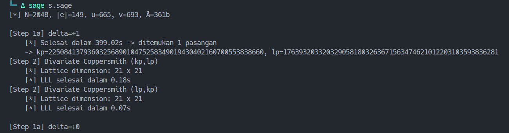
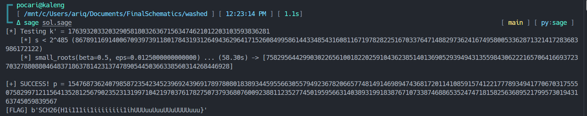

> **Category:** Cryptography · **Event:** SCHEMATICS 2026 Final · **Points:** 500  
> **Challenge author:** **Idzoyy**, whose whole description was *"mas standar e mas"*

Well, this one is special to me. **Washed** was a finals challenge, I got **first blood** 🩸 on it, and it stayed the **only solve** until the competition ended.

The description jokes that the challenge is "standard". It is RSA after all: a 2048-bit modulus, a ciphertext, and two leaks. But the leaks come from the **CRT exponents**, the exponents are **blinded**, and almost two thirds of every leaked exponent is missing. Underneath the jokes sits a 2022 research attack.

> **TL;DR:** The blinded CRT exponents satisfy $ed_p'-1=k'(p-1)$ and $ed_q'-1=l'(q-1)$. Their leaked MSBs give the product $M=k'l'$ almost exactly. A congruence modulo $e$ fixes $k'+l'$ up to a multiple of $e$, so a 4-billion-step search over that multiple splits $M$ without factoring it. With $k'$ in hand, the unknown LSBs of $d_p'$ shrink to a 485-bit root, and univariate Coppersmith ($\beta=0.5$, $\varepsilon=0.0125$) finds $p$.

---

## 1. The challenge

We get the generator and its JSON output:

```python filename="chall.py"
import json
import os
import secrets
from math import gcd

from Crypto.Util.number import getPrime, inverse

N_BITS = 2048
E_BITS = 149
BLIND_BITS = 32
UNKNOWN_P = 665
UNKNOWN_Q = 693
FLAG = os.environ.get("FLAG", "SCH{REDACTED}")


def gen_e(phi):
    while True:
        e = secrets.randbits(E_BITS) | (1 << (E_BITS - 1)) | 1
        if gcd(e, phi) == 1:
            return e


def main():
    p, q = getPrime(N_BITS // 2), getPrime(N_BITS // 2)
    n, phi = p * q, (p - 1) * (q - 1)
    e = gen_e(phi)

    dp = inverse(e, p - 1) + secrets.randbits(BLIND_BITS) * (p - 1)
    dq = inverse(e, q - 1) + secrets.randbits(BLIND_BITS) * (q - 1)

    m = int.from_bytes(FLAG.encode(), "big")
    c = pow(m, e, n)

    print(json.dumps({
        "n": n,
        "e": e,
        "dp_msb": dp >> UNKNOWN_P,
        "dq_msb": dq >> UNKNOWN_Q,
        "dp_unknown_lsb": UNKNOWN_P,
        "dq_unknown_lsb": UNKNOWN_Q,
        "ciphertext": c,
    }))


if __name__ == "__main__":
    main()
```

Three details matter:

1. $e$ is **not** 65537. It is a random **149-bit** odd number with the top bit set.
2. `dp` and `dq` are not the usual CRT exponents. Each has a random 32-bit multiple of $p-1$ (or $q-1$) added to it. This is **additive exponent blinding**, a common side-channel countermeasure.
3. We only see the top bits: the lowest **665** bits of `dp` and the lowest **693** bits of `dq` are removed.

---

## 2. Writing the leak as equations

Let $d_p=e^{-1}\bmod(p-1)$ be the real CRT exponent and $r_p<2^{32}$ the blinding factor. The challenge publishes the top bits of

$$
d_p'=d_p+r_p(p-1).
$$

Because $ed_p\equiv1\pmod{p-1}$, there is an integer $k<e$ with $ed_p=1+k(p-1)$. Adding the blinding term does not break that shape. It only makes the multiplier larger:

$$
\boxed{ed_p'-1=k'(p-1),\qquad k'=k+e\,r_p.}
\tag{1}
$$

The same holds for $q$:

$$
\boxed{ed_q'-1=l'(q-1),\qquad l'=l+e\,r_q.}
\tag{2}
$$

Now the sizes. Since $k<e<2^{149}$ and $r_p<2^{32}$, we get $k'<e(r_p+1)\lesssim2^{181}$, and the same bound holds for $l'$. Each blinded exponent is about $1024+32=1056$ bits long. Write the known part and the unknown part separately:

$$
d_p'=\tilde d_p+x,\qquad \tilde d_p=\texttt{dp\_msb}\cdot2^{665},\qquad 0\le x<2^{665},
$$

$$
d_q'=\tilde d_q+y,\qquad \tilde d_q=\texttt{dq\_msb}\cdot2^{693},\qquad 0\le y<2^{693}.
$$

| Quantity | Size |
| --- | --- |
| $N=pq$ | 2048 bits |
| $e$ | 149 bits |
| $r_p,\ r_q$ | 32 bits |
| $k',\ l'$ | about 181 bits |
| $d_p',\ d_q'$ | about 1056 bits |
| Known MSBs of $d_p'$ | $1056-665=391$ bits |
| Known MSBs of $d_q'$ | $1056-693=363$ bits |

That is roughly **a third** of each exponent. The number is a hint in itself.

---

## 3. Finding the paper

I had seen this flavour of challenge before. **Delusion** at Arkavidia was an RSA challenge that leaked MSBs and LSBs, and it was built on a paper. So I went looking for a paper again. DeepSeek and a Google search both pointed to the same one:

> **"A Third is All You Need: Extended Partial Key Exposure Attack on CRT-RSA with Additive Exponent Blinding"**, Zhou, van de Pol, Yu and Standaert, ASIACRYPT 2022, **IACR ePrint 2022/1163**.

It extends the May–Nowakowski–Sarkar attack from Eurocrypt 2022 ("factoring with only a third of the secret CRT exponents") to blinded exponents. Then I found the line that convinced me. Table 1 of the paper, the MSB case, contains this row:

| $\lvert N\rvert$ | $\lvert e\rvert$ | $\lvert r_p\rvert,\lvert r_q\rvert$ | unknown LSBs | Step 1a (factoring) | Step 2 lattice dim. | LLL |
| --- | --- | --- | --- | --- | --- | --- |
| 2048 | 149 | 32 | 665 / **693** | 42 s | 21 | 4 s |

These are exactly the challenge parameters: `N_BITS = 2048`, `E_BITS = 149`, `BLIND_BITS = 32`, `UNKNOWN_P = 665`, `UNKNOWN_Q = 693`. The attack has two steps:

1. **Step 1:** recover the constants $k'$ and $l'$.
2. **Step 2:** use $k'$ and the known MSBs of $d_p'$ to factor $N$ with Coppersmith's method.

---

## 4. Step 1a: the product k′l′ from the MSBs

Multiply (1) and (2):

$$
(ed_p'-1)(ed_q'-1)=k'l'(p-1)(q-1).
$$

Both sides are about $2^{2410}$. Replacing $(p-1)(q-1)$ with $N$ and dropping the $-1$ terms changes the quotient by far less than one, so

$$
k'l'\approx\frac{e^2d_p'd_q'}{N}.
$$

We do not know $d_p'$ and $d_q'$, only their top bits. So we use the paper's estimate:

$$
\boxed{\tilde A=\frac{e^2\,\tilde d_p\,\tilde d_q}{N}.}
\tag{3}
$$

How far off is it? The missing part is

$$
\frac{e^2(d_p'd_q'-\tilde d_p\tilde d_q)}{N}=\frac{e^2(\tilde d_p\,y+\tilde d_q\,x+xy)}{N}.
$$

The largest term is $e^2\tilde d_p\,y/N<2^{298+1056+693-2047}=1$, and the others are much smaller. The estimate only ever **undershoots** ($x,y\ge0$), and by less than about 1. So $k'l'=\lceil\tilde A\rceil$, which in code is

$$
M=\lfloor\tilde A\rfloor+1.
$$

In the solver this is `delta = +1`, and it was indeed the delta that worked. $M$ is a **361-bit** number.

---

## 5. Step 1b: splitting M without factoring it

The paper's Step 1a factors $M$. A 109-digit composite takes about 42 seconds with a serious factoring tool. I tried PARI's `factorint` and Sage's quadratic sieve, and neither finished in reasonable time on my machine. So I used a different handle: a **congruence modulo $e$**.

Reduce (1) and (2) modulo $e$:

$$
k'(p-1)\equiv-1\pmod e\quad\Longrightarrow\quad k'p\equiv k'-1\pmod e,
$$

$$
l'(q-1)\equiv-1\pmod e\quad\Longrightarrow\quad l'q\equiv l'-1\pmod e.
$$

Multiply the two and use $pq=N$:

$$
k'l'N\equiv(k'-1)(l'-1)=k'l'-(k'+l')+1\pmod e,
$$

which rearranges to

$$
\boxed{k'+l'\equiv1-M(N-1)\pmod e.}
\tag{4}
$$

So the **sum** $k'+l'$ is known modulo the 149-bit number $e$. The sum itself is only about 182 bits, which leaves a gap of just **33 bits**:

$$
k'+l'=c+e\,t,\qquad t\in\mathbb Z,
$$

$$
c=\big(1-M(N-1)\big)\bmod e.
$$

For each guess of $t$ we know both the sum $s=c+et$ and the product $M$, so $k'$ and $l'$ are the roots of

$$
X^2-sX+M=0.
$$

The guess is right exactly when the discriminant is a perfect square:

$$
\boxed{\Delta(t)=(c+et)^2-4M=\square}
\tag{5}
$$

and then

$$
\{k',l'\}=\left\{\frac{s+\sqrt{\Delta(t)}}{2},\ \frac{s-\sqrt{\Delta(t)}}{2}\right\}.
$$

The search range follows from the sizes. By AM–GM, $s\ge2\sqrt M$. And $k',l'<2^{181}$ gives $s<2^{182}$. That leaves

$$
t\in\left[\frac{2\sqrt M-c}{e},\ \frac{2^{182}-c}{e}\right],
$$

which is **3,971,790,125** candidates in my instance.

In pure Python that loop is hopeless: it takes hours. Written in **Cython** with `gmpy2` (`is_square`, `isqrt`), the first and only hit appeared after about 55 million steps, in **5.48 s**. A full scan of all ~4 billion candidates took **399 s** and confirmed that the pair is unique:

```text
M (361 bits, split over three lines) =
397033121071315838571539450891592173568548
529696085672643879884666529090501768438603
6815954994608170128423460

r1 =
2250841379360325689010475258349019430402160700553838660

r2 =
1763932033203290581803263671563474621012203103593836281
```

Both roots are 181 bits long, and $r_1r_2=M$ exactly.

> **Keep this in mind for later:** the quadratic hands back an **unordered** pair. Nothing in (5) says which root is $k'$ (the one tied to $p$) and which is $l'$.

---

## 6. Step 2: from k′ to p with Coppersmith

Rewrite (1) with the unknown LSBs separated out:

$$
e(\tilde d_p+x)-1+k'=k'p.
$$

Define the known constant $B=e\tilde d_p-1+k'$. Then

$$
\boxed{ex+B=k'p.}
\tag{6}
$$

### Shrinking the unknown with k′

Equation (6) holds over the integers, so it also holds modulo $k'$: $ex+B\equiv0\pmod{k'}$. Since $\gcd(e,k')=1$ (the solver checks it), this pins down $x$ modulo $k'$:

$$
x\equiv r:=-B\,e^{-1}\pmod{k'}.
$$

So we write $x=r+k's$ with

$$
0\le s<\frac{2^{665}}{k'}\approx2^{485}.
$$

Substituting back into (6) and dividing by $k'$ gives an exact formula for $p$:

$$
e(r+k's)+B=k'p,
$$

$$
\boxed{p=e\,s+C,\qquad C=\frac{B+er}{k'}\in\mathbb Z.}
\tag{7}
$$

Knowing $k'$ took **181 bits** off the unknown: from $x<2^{665}$ down to $s<2^{485}$.

### A small root modulo an unknown factor

Make (7) monic by multiplying with $e^{-1}\bmod N$:

$$
f(s)=s+C\,e^{-1}\bmod N,\qquad f(s_0)\equiv e^{-1}p\equiv0\pmod p.
$$

This is Howgrave-Graham's setting: a monic polynomial modulo $N$ with a small root modulo an unknown divisor $p\ge N^{\beta}$. Coppersmith's method finds every root with

$$
|s_0|<N^{\beta^2-\varepsilon},\qquad\beta=\tfrac12\ \Longrightarrow\ |s_0|<N^{1/4-\varepsilon}=2^{512-2048\varepsilon}.
$$

Our root needs $485<2048\left(\tfrac14-\varepsilon\right)$, so

$$
\boxed{\varepsilon<\frac{512-485}{2048}\approx0.0132.}
\tag{8}
$$

This explains my earlier failures. With $\varepsilon=0.05$ the bound is $2^{409.6}$, and with $0.02$ it is $2^{471}$. Neither can ever reach a 485-bit root. With $\varepsilon=0.0125$ the bound is $2^{486.4}$, a margin of just 1.4 bits. Sage's `small_roots` then uses $m=\lceil\beta^2/\varepsilon\rceil=20$ and $t=\lfloor m(1/\beta-1)\rfloor=20$, which gives a $40\times40$ lattice. LLL on it took **58.30 s**.

### Why only the dp side works

The same reduction on the $q$ side leaves $s_q<2^{693}/l'\approx2^{512}$. That sits right at $N^{1/4}$, and no $\varepsilon>0$ gets past it. So the 28 extra unknown bits on `dq` make that side useless on its own. The attack has to go through $d_p'$, and through the root that really is $k'$.

---

## 7. The bug that ate my time: which root is k′?

Step 1 printed the pair in a fixed order:

```text
kp = (s + d) // 2  ->  2250841379…553838660  (larger)
lp = (s - d) // 2  ->  1763932033…593836281  (smaller)
```

My first univariate solver plugged the larger root into the $d_p$ equation. With the wrong multiplier, $x\equiv r\pmod{k'}$ is meaningless, so `small_roots` correctly found nothing. Every run ended in either `ArithmeticError` or `no roots`.

I concluded that the univariate method was too weak. I spent a long time on a **bivariate 21 × 21 lattice** instead, trying to match the "Step 2 lattice dim. 21" in the paper. LLL finished in about 0.1–0.2 s and never produced a usable root. I even started to suspect the pair itself.

The real fix was one line: **try the smaller root as $k'$**. With

```text
k' =
1763932033203290581803263671563474621012203103593836281
```

the univariate solver from Section 6 returned the root on its first $\varepsilon$, and $p$ followed from (7).

> **Lesson:** when an algebraic step returns a symmetric pair, test **both** assignments in the next step, or check them right away. In this case, (6) holds over the integers only for the true $k'$.

---

## 8. Solver

### Step 1: recover (k′, l′) with Cython, excerpt of s.sage

The search runs in Cython so that 4 billion iterations finish in minutes instead of hours. The bivariate Step 2 from my original `s.sage` is left out here, because it never found the root. This trimmed version prints English messages; the screenshot below comes from my original run, whose messages were in Indonesian.

```sage filename="s.sage"
#!/usr/bin/env sage
import json
import time
from sage.all import *
from sage.repl.user_globals import set_globals

set_globals(globals())   # cython() needs this when run as `sage s.sage`

cython("""
from libc.stdint cimport uint64_t
import gmpy2

def c_t_search_all(M_obj, e_obj, n_obj, int blind_bits=32):
    cdef object M = gmpy2.mpz(int(M_obj))
    cdef object e = gmpy2.mpz(int(e_obj))
    cdef object n = gmpy2.mpz(int(n_obj))
    cdef object c = (gmpy2.mpz(1) - M * (n - gmpy2.mpz(1))) % e
    cdef object sqrt_M = gmpy2.isqrt(M)
    cdef object max_k = gmpy2.mpz(1) << int(int(e_obj).bit_length() + blind_bits)
    cdef object t_lo = max(gmpy2.mpz(1), (gmpy2.mpz(2) * sqrt_M - c) // e)
    cdef object t_hi = (gmpy2.mpz(2) * max_k - c) // e + gmpy2.mpz(2)
    cdef object s = c + e * t_lo
    cdef object four_M = gmpy2.mpz(4) * M
    cdef object v, d, kp, lp
    cdef object is_sq = gmpy2.is_square
    cdef object isqrt = gmpy2.isqrt
    cdef uint64_t i, steps = <uint64_t>(t_hi - t_lo)
    cdef list results = []

    for i in range(steps):
        v = s * s - four_M
        if v >= 0 and is_sq(v):
            d = isqrt(v)
            kp = (s + d) >> 1
            lp = (s - d) >> 1
            if kp * lp == M and kp > 1 and lp > 1:
                results.append((int(kp), int(lp)))
        s += e
    return results
""")

with open("challengefix.json") as f:
    data = json.load(f)

n, e = int(data["n"]), int(data["e"])
u, v = int(data["dp_unknown_lsb"]), int(data["dq_unknown_lsb"])
dp_known = int(data["dp_msb"]) << u
dq_known = int(data["dq_msb"]) << v

A_tilde = (e * e * dp_known * dq_known) // n
print(f"[*] N={n.bit_length()}, |e|={e.bit_length()}, u={u}, v={v}, Ã={A_tilde.bit_length()}b")

for delta in (1, 0, 2, 3):          # k'l' = ceil(Ã), so +1 first
    M = A_tilde + delta
    t0 = time.time()
    print(f"\n[Step 1a] delta={delta:+d}", flush=True)
    pairs = c_t_search_all(M, e, n, 32)
    print(f"    [*] done in {time.time() - t0:.2f}s -> {len(pairs)} pair(s)")
    for kp, lp in pairs:
        print(f"    -> kp={kp}, lp={lp}")
    if pairs:
        break
```



### Step 2: univariate Coppersmith with the correct k′, sol.sage

```sage filename="sol.sage"
#!/usr/bin/env sage
import json
import time
from sage.all import *

def coppersmith_univariate(n, e, dp_known, u, kp):
    A_p = e * dp_known - 1
    B_p = A_p + kp                       # e*x + B_p = k'*p   (6)

    if gcd(e, kp) != 1 or gcd(e, n) != 1:
        print("    [!] gcd check failed")
        return None, None

    r = (-B_p * inverse_mod(e, kp)) % kp  # x = r + k'*s
    num = B_p + e * r
    if num % kp != 0:
        print("    [!] divisibility check failed")
        return None, None
    c = num // kp                         # p = e*s + c   (7)

    s_bound = (1 << u) // kp + 1
    print(f"    [*] s < 2^{s_bound.bit_length()} ({s_bound})")

    e_inv = inverse_mod(e, n)
    R = PolynomialRing(Zmod(n), 's')
    s = R.gen()
    f_monic = R(s + (c * e_inv) % n)      # monic, root modulo p

    # s < 2^485 and beta = 0.5  ->  eps must stay below (512 - 485) / 2048 ~ 0.0132
    # eps = 0.0125 -> m = 20, t = 20 -> a 40 x 40 lattice
    for eps in (0.0125, 0.012, 0.011, 0.01, 0.009):
        t0 = time.time()
        print(f"    [*] small_roots(beta=0.5, eps={eps}) ...", end=" ", flush=True)
        try:
            roots = f_monic.small_roots(X=s_bound, beta=0.5, epsilon=eps)
        except Exception as ex:
            print(f"err: {ex}")
            continue
        print(f"({time.time() - t0:.2f}s) -> {roots}")
        if roots:
            for s0 in roots:
                x0 = r + kp * int(s0)
                p = gcd(B_p + e * x0, n)
                if 1 < p < n:
                    return int(p), x0
    return None, None

def decrypt(n, e, c, p):
    q = n // p
    d = inverse_mod(e, (p - 1) * (q - 1))
    m = pow(c, d, n)
    return int(m).to_bytes((int(m).bit_length() + 7) // 8, 'big')

with open("challengefix.json") as f:
    data = json.load(f)

n = int(data["n"])
e = int(data["e"])
c = int(data["ciphertext"])
u = int(data["dp_unknown_lsb"])
dp_known = int(data["dp_msb"]) << u

# the SMALLER root from Step 1 is the k' that belongs to p
kp_true = 1763932033203290581803263671563474621012203103593836281
print(f"[*] Testing k' = {kp_true}")
p, x0 = coppersmith_univariate(n, e, dp_known, u, kp_true)
if p:
    print(f"\n[+] SUCCESS! p = {p}")
    print(f"[FLAG] {decrypt(n, e, c, p)}")
else:
    print("\n[-] Failed")
```



The whole path in one picture:

```text
dp_msb, dq_msb
   │   Ã = e²·d̃p·d̃q / N
   ▼
M = ⌊Ã⌋ + 1 = k'·l'                     (361 bits)
   │   k' + l' ≡ 1 − M(N − 1)  (mod e)
   ▼
t-search: (c + e·t)² − 4M is a square
          (~4·10⁹ candidates, Cython)
   │
   ▼
{k', l'}  →  try BOTH as k'
   │   x = r + k'·s,  p = e·s + C,  s < 2^485
   ▼
small_roots(β = 0.5, ε = 0.0125)  →  p
   │
   ▼
q = N / p  →  d = e⁻¹ mod φ(N)  →  flag
```

A note on Step 1: it probably is not the intended route. The paper factors $M$ (42 s in its Table 1), and I could not reproduce that step in time, so I used the congruence search above. It worked, and that is what counts in a final.

---

## 9. Flag

```text
SCH26{H1i111ii1iiiiiiii1ihUUUuuUuuUUuUUUUuuu}
```

---

## AI Transparency

I solved this challenge with help from two AI assistants. Here is what each one did, including the parts where they were wrong.

**1. DeepSeek:** [chat.deepseek.com/share/2rmqdhsilhwavuwdok](https://chat.deepseek.com/share/2rmqdhsilhwavuwdok)

- Confirmed the setup: RSA with additively blinded CRT exponents and partial MSB leaks.
- Identified **IACR ePrint 2022/1163** and explained the two-step attack (recover $k'$, then Coppersmith).
- After I gave it the paper, pointed to the congruence $k'+l'\equiv1-k'l'(N-1)\pmod e$ and proposed the **t-search** from Section 5, instead of factoring $M$.
- Wrote the first Sage solvers. Phase 1 found the pair, but every Phase 2 attempt ended in `ArithmeticError` or `no roots`, and the chat ended without a working Step 2.

**2. Google Search AI Mode:** [share.google/aimode/yVVduQpYguURTCJpR](https://share.google/aimode/yVVduQpYguURTCJpR)

- Explained why `small_roots` with $\varepsilon\ge0.0132$ can never reach a 485-bit root (Section 6).
- Moved the t-search into **Cython** with `gmpy2` (5.48 s to the hit, 399 s for a full scan). It also suggested `yafu` or `cado-nfs` as an alternative way to factor $M$.
- Spent many rounds on a bivariate 21 × 21 lattice that never produced a root.
- Finally found the real bug: the univariate step had only ever been run with the **larger** root. With $k'=$ `1763932033…3593836281` and $\varepsilon=0.0125$, it recovered $p$.

**Where the assistants were wrong**, so readers do not copy the mistakes:

- **The univariate lattice is not 21-dimensional, and it did not take 4 s.** Both claims came from Google AI Mode. Sage builds a $40\times40$ lattice ($m=t=20$) for $\varepsilon=0.0125$, and LLL took 58.30 s. The "dimension 21, 4 s" in the paper's Table 1 refers to the paper's own Step 2 lattice.
- **The pair was not a false positive.** Google AI Mode also suggested that the larger root could not be real because it is even. Its proposed filter `gcd(kp, 30030) != 1` then threw away the true pair. Nothing forces $k'$ or $l'$ to be odd.
- **The search was not fast.** The early estimates said a few seconds in plain Python. The real loop needed Cython and still took 399 s for the full range.

*Thanks for reading. GG to Idzoyy for a "standard" challenge that was anything but.*
